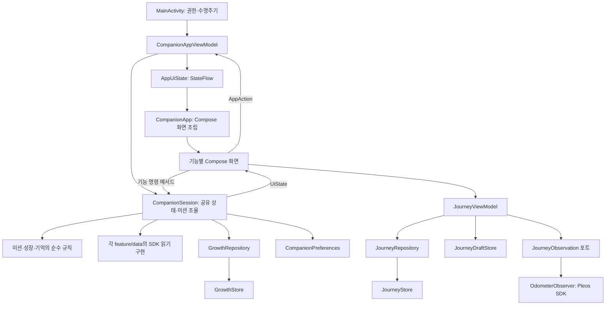

# PleosMate Android 아키텍처

- 기준일: 2026-11-10 패키지 구조 확인
- 구조: 단일 `app` Gradle 모듈, feature-first 패키지, 화면 상태의 단방향 흐름
- 현재 기능의 기준은 `app/src/main/java/com/pleos/mate/feature/`와 대응 테스트다. 과거 요구사항 문서는 현재 사양으로 간주하지 않는다.
- 구현 방식: 필요한 기능에 presentation/domain/data를 두고, 앱 객체 생성은 Hilt가 담당한다. use case·멀티모듈은 필요가 생길 때 도입한다.

## 1. 실제 소스 구조

기준 경로는 `app/src/main/java/com/pleos/mate/`다.

```text
MainActivity.kt                       Android 진입점·권한·수명주기
app/
  CompanionApp.kt                     화면 조립과 레이아웃
  CompanionAppViewModel.kt             앱 상태·Action·세션 수명 관리
  PleosMateApplication.kt              Hilt 시작점
  di/                                  저장소·SDK 구현·세션 제공 모듈
  navigation/                         AppTab·AppUiState·AppAction·순수 reducer·하단 탐색
core/
  designsystem/                       테마·공통 카드·아이콘·입력 스타일
  pet/model/                          캐릭터·성장 외형·모션 정보
  pet/rendering/                      2.5D/픽셀 렌더러와 View
  pet/presentation/                   공용 PetStage·모션 선택 UI
  vehicle/                            공용 주차·CarUxRestrictions 접근
data/local/
  CompanionPreferences.kt             선택·이름·꾸미기·음성·안내 이력
feature/
  onboarding/presentation/            동료 선택 화면
  home/presentation/                  홈 화면
  companion/domain/                   꾸미기 해금과 기억 기반 재회
  companion/presentation/             꾸미기·말풍선
    session/                          CompanionSession·ExperienceSession·읽기 전용 UiState
  missions/domain/                    미션별 시작·완료·보상 정책과 주기·유효값 규칙
  missions/data/vehicle/              Window/Door/Vehicle 읽기와 구독
  missions/data/location/             장소·목적지 읽기
  missions/data/voice/                TTS/STT 연결
  missions/presentation/              미션 목록·항목·경험 입력
  growth/domain/                     XP·레벨·중복 보상 규칙
  growth/data/local/                 성장 파일 저장소·직렬 비동기 repository
  collection/domain/                 영속 claim에서 계산하는 성장 이야기
  collection/presentation/           배지·이야기·기억 표시와 공유
  journey/domain/                    관찰 샘플·구간·초안·저장 규칙·관찰 포트
  journey/data/local/                JourneyStore·JourneyRepository·JourneyDraftStore
  journey/data/vehicle/              OdometerObserver·PleosJourneyObservationFactory
  journey/presentation/              JourneyViewModel·JourneyUiState·기억 편집
  exploration/data/                  지역 단위·지도 영역 데이터 읽기
  exploration/presentation/          탐험 지도·지역 선택·방문 확인·기념품 수집 UI
  settings/presentation/             설정·초기화 안내
  developer/presentation/            debug 도구 진입 화면
```

탐험은 `AppTab.EXPLORE`에서 `ExplorationScreen`으로 연결된다. 지역 경계와 이름표는 앱 assets에서 읽으며, 사용자가 선택한 지역의 방문 확인 및 저장은 동료 세션·성장 저장 흐름과 연동된다. 화면에 표시되는 지역 선택 가능 여부와 방문 확인 조건은 구현 및 테스트를 기준으로 판단한다. 이 구조는 서버 계정이나 클라우드 동기화를 뜻하지 않는다.

진단 Activity는 `app/src/debug/java/com/pleos/mate/feature/developer/presentation/`에 있다. release에서는 해당 Activity를 포함하지 않고 탐색에서도 개발 도구를 노출하지 않는다. 런처 `com.pleos.mate.MainActivity`는 유지한다.

## 2. 화면과 데이터 흐름



`AppAction`은 선택·이름·탭 이동·뒤로가기를 표현한다. reducer는 상태 전이를 계산하고 ViewModel은 저장과 진행 중 미션 취소 같은 동작을 수행한다. 화면은 `StateFlow`를 lifecycle에 맞춰 관찰한다. 확정 전 이름과 동료는 초안이며 취소하면 저장된 선택을 유지한다.

미션/경험/여정은 기존 검증 로직을 유지한 명령 메서드와 불변 `CompanionUiState`, `ExperienceUiState`, `JourneyUiState`로 동작한다. 이 세 상태는 현재 Compose snapshot으로 관찰한다. 외부에서 상태를 쓰지 못하며 변경은 state holder의 명령을 통해 처리한다. 모든 화면에 reducer·빈 ViewModel을 추가하는 엄격한 MVI 구조는 아니다.

## 3. 객체의 책임과 수명

| 객체 | 책임 | 수명 |
| --- | --- | --- |
| `MainActivity` | 권한 결과와 Android 수명주기 전달, Compose 시작 | Activity 인스턴스 |
| `CompanionAppViewModel` | 탐색 상태·초안 복원, Hilt 주입 세션 소유·종료 | ViewModelStore. 구성 변경 시 유지 |
| `CompanionSession` | 주차 상태·보상 저장·중복 방지·펫 반응 조율 | 위 ViewModel이 소유. resume/pause로 리스너를 관리 |
| `ExperienceSession` | 위치/음성의 임시 입력과 유효성·취소 | CompanionSession 소유 |
| `JourneyViewModel` | 관찰 구간·기억 초안·편집과 저장 상태 | ViewModelStore. 최종 정리 시 관찰 중단 |
| `WindowMissionReader`, 자동 관찰자 등 | SDK 연결·구독·현재값·정리 | 세션의 현재 작업/활성 구간 |
| `GrowthRepository`, `JourneyRepository` | 직렬 I/O, 결과를 main thread로 전달 | application component singleton |
| `GrowthStore`, `JourneyStore`, preferences adapter | 기존 형식의 로컬 영속 데이터 | SDK/화면과 독립된 데이터 구현 |

`CompanionSession`은 여러 화면이 공유하는 실시간 차량 관찰과 미션 완료 흐름을 조율한다. 창문·도어·차량 정보 미션의 시작 가능 조건, 유효성·신선도와 주간 보너스 판정은 각각 `WindMissionRules`, `DoorMissionRules`, `VehicleMissionRules`가 소유한다. SDK 호출·관찰 수명과 화면 상태, 저장 순서는 세션에 남긴다. 따라서 이벤트별 정책은 분리됐지만 비동기 작업 조율은 여전히 한 state holder에 있다.

Hilt는 `MainActivity`와 두 ViewModel을 생성한다. `CompanionSession`은 `CompanionAppViewModel`의 ViewModel component 범위에서 제공되고, 저장소와 기존 preference adapter는 application component에서 제공된다. 성장 파일 I/O와 직렬 쓰기는 `GrowthRepository`가, 이동 기록 I/O는 `JourneyRepository`가 담당한다. 각 ViewModel은 해당 repository 결과로 상태를 갱신하고 화면 흐름을 조율한다. 여정 ViewModel은 `JourneyRepository`, `JourneyDraftStore`, `JourneyObservationFactory`를 생성자 주입받는다. Pleos 구현은 `PleosJourneyObservationFactory`가 `OdometerObserver`를 만든다. 단위 테스트는 fake factory를 전달할 수 있다.

## 4. 변경 시 지킬 경계

- feature의 domain은 Android·Compose·Pleos SDK를 import하지 않는다.
- 모델은 유효성, 변환, 파생값처럼 해당 데이터의 불변 규칙을 소유할 수 있다. 저장·SDK 접근과 화면 표시 책임은 모델에 넣지 않는다.
- `core/pet/model`은 Android resource ID를 갖지 않는다. 캐릭터 이름·설명 같은 화면 문자열 매핑은 pet presentation이 맡는다.
- 공통 `core`는 feature를 import하지 않는다. 실제 미션/기억을 조율하는 코드는 companion feature의 presentation/session이 소유한다.
- 화면은 SharedPreferences를 직접 읽고 쓰지 않는다. 저장 포맷·키는 data 구현에서 관리한다.
- Hilt 모듈은 `app/di` 조립 경계에 둔다. feature domain은 Hilt annotation이나 Android 의존성을 갖지 않는다.
- 편집 모드는 `JourneyEditorMode`로 표현하며 저장소 경계에서 기존 모드 문자열을 유지한다. 글자 수 제한, 수동 기록 생성, 기억 메타데이터 수정은 journey domain model이 맡는다.
- 차량 미션의 시작·판정·주간 보너스 조건은 missions domain 정책 객체에 둔다. SDK listener의 시작·취소·저장 순서와 Compose 상태 변경은 session이 조율한다.
- 읽기/구독/해제는 SDK data 구현이 담당하고, XP·미션 완료 결정은 세션과 순수 규칙이 담당한다.
- 한 feature의 임시 편집 상태와 여러 화면이 공유하는 성장 상태를 중복 저장하지 않는다.
- use case는 여러 state holder가 같은 복잡한 작업을 재사용할 때 추출한다. 단순 저장/조회 전달용 클래스는 먼저 만들지 않는다.

단일 Gradle 모듈의 패키지 경계이므로 모듈 간 가시성은 아직 컴파일러로 강제하지 않는다. 기능별 팀 소유권·빌드 분리 필요가 생길 때 모듈화를 검토한다.

## 5. 데이터와 동작 호환

앱 ID·런처·FileProvider authority, 성장/여정 파일 형식, `companion`·`journey_editor`·`mission_guidance` preference 이름과 키를 유지했다. 패키지 이동은 저장 데이터를 초기화하지 않는다. debug 진단 Activity와 XML custom View의 클래스 경로는 새 패키지로 갱신했다.

이번 작업은 지도·이동 XP·B2B 할인 기능을 추가하지 않는다. 이후 지도는 journey의 검증된 구간을 입력으로 사용하고, 보상 규칙은 growth/domain에서 다룬다. 파트너 할인은 계약/API가 구체화된 뒤 별도 feature의 데이터 경계를 설계한다.

## 6. 2026-11-01 검증 기록

- 변경 전: 단위 테스트 89개 중 88개 통과. `PetCollectionTest.reunionNeverInventsOrRestoresDeletedMemories`의 첫 바람 재회 문구 기대값에서 실패.
- 변경 후 아키텍처 기준: 탐색/선택 reducer 테스트 6개 추가, 이후 책임 분리 테스트와 미션 정책 테스트를 더했다. 현재 101개 중 100개 통과. `PetCollectionTest.reunionNeverInventsOrRestoresDeletedMemories`는 변경 전부터 실패한 같은 테스트이며, 뒤쪽 삭제 assertion까지 통과했다고 간주하지 않는다.
- debug·release·Android 테스트 APK 빌드와 Android 테스트 소스 컴파일 통과. release는 기본 unsigned 산출물이며 스토어 서명/배포를 완료했다는 의미가 아니다.
- Pleos Connect v2.1.0 AVD에서 `JourneyLifecycleTest`와 `GrowthRepositoryTest` 통과: 격리 저장소의 초안 복원·주차 제한·저장·수정·삭제, 성장 기록 직렬 I/O와 main-thread callback 확인.
- 같은 AVD 사용자 10에서 `NavigationLifecycleTest` 통과: 미션 탭을 선택하고 Activity를 재생성한 후 같은 ViewModel·탭 상태가 유지되며, 저장된 동료 종류·이름·꾸미기 프로필은 바뀌지 않음. 펫의 무한 애니메이션 idle 대기를 피하도록 정적인 미션 화면에서 수명주기를 검사한다.
- 기존 데이터를 초기화하지 않는 업데이트 설치와 제품 홈 렌더 확인. release Manifest에는 런처가 유지되고 진단 Activity가 없는 것을 확인했다.
- 새 패키지의 `PetMotionPreviewActivity`를 실행해 XML의 `PetMotionView` 클래스 경로와 펫 렌더가 연결되는 것을 확인했다.
- 순수 domain과 `core/pet/model`에 Android/Compose/SDK/resource import가 없고, 공통 core에서 feature import가 없는 것을 확인했다.
- 기존 Kotlin 파일 중 32개는 package/import 외 본문이 동일하다. 렌더 원화·파일 키·XP 규칙은 이번 변경 대상에 포함하지 않았다.

미션·실차 동작 검증은 별도 작업이다. 이 문서는 패키지 구조 설명이며, 상세 검증 기준을 명세하지 않는다.

### Hilt 적용 확인

- `@HiltAndroidApp` Application, `@AndroidEntryPoint` Activity, `@HiltViewModel` 두 ViewModel로 생성 경로를 옮겼다. Hilt compiler는 KSP를 사용한다(AGP 9 내장 Kotlin 환경에서는 KAPT를 쓸 수 없음).
- `CompanionSession`은 CompanionAppViewModel 범위, 로컬 저장소와 preferences는 application 범위다. Activity에서 ViewModel factory와 저장소/SDK 객체를 직접 만들지 않는다.
- debug APK, unsigned release APK, Android 테스트 APK 빌드가 통과했다. 전체 단위 테스트 101개 중 100개 통과했으며 `JourneyEditorTest`와 `MissionPolicyTest`도 통과했다. 기존 `PetCollectionTest.reunionNeverInventsOrRestoresDeletedMemories` 실패 1건은 그대로다.
- 실물 Galaxy SM-S938N에는 설치하지 않았다. Pleos Connect AVD에서 `JourneyLifecycleTest`와 `GrowthRepositoryTest` 통과로 격리 저장소 동작과 앱 테스트 프로세스 시작을 확인했다. Hilt ViewModel을 통한 MainActivity 화면 생성/Activity 재생성은 이번에는 별도 실행하지 않았다.
- 책임 분리 점검에서 성장·이동 기록의 직렬 I/O를 각 repository로 옮기고, journey 편집 모드의 문자열을 enum으로 바꿨다. 편집 길이 제한·수동 기억 생성·기존 기억 메타데이터 수정은 domain 모델 메서드가 처리하며 저장 문자열은 호환된다.
- 차량 미션 정책 점검에서 창문·도어·차량 정보 미션의 시작 조건과 보상 판정을 `missions/domain` 객체로 분리하고 단위 테스트로 검증했다. SDK 관찰의 비동기 조율은 `CompanionSession`에 남아 있다.

## 서버 데이터 공급처 준비 (2026-11-02)

- 성장 기록: `GrowthRepository`는 `GrowthDataSource`를 사용한다. 현재 Hilt는 파일 기반 `GrowthStore`를 연결한다. 미션 완료, XP, 배지는 같은 성장 기록에서 파생되므로 개별 저장소로 중복 저장하지 않는다.
- 여정 기록: `JourneyRepository`는 `JourneyDataSource`를 사용한다. 현재 구현은 `JourneyStore`이며 편집 초안은 기기 로컬 `JourneyDraftStore`에 유지한다.
- 계정 프로필: `PetProfileDataSource`는 캐릭터, 이름, 의상, 방 정보를 분리한다. 현재는 기존 `CompanionPreferences`가 구현하며 저장 키를 유지한다. 음성 설정과 안내 열람 이력은 기기 설정으로 남는다.
- 이 계약은 현재 동기 로컬 접근용이다. 성장·여정 repository는 백그라운드에서 호출한다. 프로필 원격 연동 시에는 로컬 캐시를 유지하고 비동기 repository 동기화 경로를 추가해야 한다. 프로필 getter에서 네트워크를 호출하면 안 된다.
- 미션 카탈로그와 레벨 곡선은 현재 코드 정의다. 서버 카탈로그는 ID·버전·보상 계약과 캐시 정책을 확정한 뒤 추가한다. 서버 XP 확정, 충돌 해결, 재시도 큐와 고유 완료 이벤트는 아직 구현하지 않았다. 현재 `save`를 원격으로 교체하는 것만으로 금전 리워드 검증이 완성되지는 않는다.
