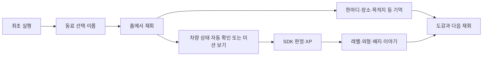

# PleosMate 개발계획서

- 기준일: 2026-11-01
- 현재 단계: Android MVP 시제품 구현 완료 단계. 마켓 출시 준비·실차 검증·사용자 수요 검증 전
- 제품 기준: [PRD](./pleos-vehicle-companion-prd.md)
- 상세 SDK 판정: [미션 카탈로그](./design/sdk-mission-catalog.md)
- 사업화 검증: [사업화 계획](./business-validation-plan.md)
- 현재 코드 구조: [Android 아키텍처](./architecture.md)

2026-11-01 구조 개선: 단일 모듈의 feature-first 패키지로 화면·규칙·SDK·저장을 분리했다. 앱 탐색은 ViewModel·StateFlow·Action/reducer로, 미션/여정은 불변 UiState와 명령 메서드로 관리한다. Hilt가 Activity와 ViewModel을 생성하고, `CompanionSession`은 앱 ViewModel 수명에 맞춘다. MainActivity는 Android 호스트 역할을 담당한다. 상세 변경과 기존 테스트 실패 1건은 아키텍처 문서의 검증 기록을 따른다.

## 1. 현재 구현 범위

| 영역 | 현재 앱 |
| --- | --- |
| 플랫폼·UI | Kotlin Android, Jetpack Compose, Pleos Connect 용 앱 |
| 탐색 | 홈·미션·도감·설정 플로팅 탭, 오른쪽 동료 선택 버튼. 개발 도구는 debug 전용 탭 |
| 동료 | 곰·토끼·픽셀 여행자·도트 구름 요정·씨앗 정령·미니 자동차 로봇. 전 캐릭터 Lv.1·5·15 외형 |
| 시각 표현 | 곰·토끼는 Canvas 기반 2.5D, 네 픽셀 캐릭터는 애니메이션 아틀라스 |
| 성장·수집 | 미션 XP·레벨·꾸미기·배지 13종·성장 이야기 3종 |
| 차량 미션 | Window/Door 자동 상태 확인, AVD에서 조회·보상까지 확인한 Vehicle 조회 10종 |
| 기억 | 한마디·장소·목적지·음성 흐름, 일일/주간 기억, 지원 범위의 여정 관찰·수동 기억 |
| 데이터 | 로컬 저장·재실행 복원. 계정·클라우드 동기화·개인별 프로필 분리 미구현 |

위 표는 구현 상태 요약이며 실차 지원 전체, 목적지 도착 성공, 모든 배지 획득, 실제 발화 인식 품질을 보증하지 않는다. 정확한 통과/미검증 경계는 제안서와 미션 카탈로그에서 확인한다.

## 2. 제품 흐름

모든 흐름은 앱이 허용된 주차 상태에서 수행한다. 차량 조작은 하지 않는다. 앱이 종료된 시간의 SDK 변화를 추정하지 않으며, 주행 중 자동 달리기는 제공하지 않는다.

## 3. 다음 개발 단계

### 단계 A — 공모전/출시용 신뢰성 고정

1. **Release 산출물:** release variant 빌드·서명·설치·재실행을 확인하고 debug 개발 도구 탭이 노출되지 않는지 확인한다.
2. **초기 사용자 흐름:** 새 데이터로 동료 선택 → 차량 미션 → XP·레벨 → 기억 → 앱 재실행 복원을 확인한다.
3. **미완료 흐름:** Door 주간 3일, 추억 주간 3일, 목적지 근접 성공, 첫 인사 실제 발화 성공, 13개 배지 획득/공유를 각 시나리오로 확인한다.
4. **차량 호환 UI:** capability·권한 조회 결과에 따라 참여 가능, 미지원, 권한 필요, 일시 오류를 분리해 보여준다. 기본 동작 미지원 차량에서도 기억·도감 같은 비차량 흐름은 사용할 수 있어야 한다.
5. **화면 QA:** 글자·대비·터치 영역·주야간·창 크기·뒤로가기·중단 복귀를 점검한다. 겹친 surface나 이미지 배경/패딩도 기기에서 확인한다.

**완료 기준:** 새 사용자 시연을 반복 재현할 수 있고, 실패·미지원 상태에서 허위 완료나 중복 XP가 없으며, 산출물의 검증 환경과 제한이 문서화되어 있다.

### 단계 B — 고객 문제 및 반복 사용 검증

1. Pleos 운전자와 차량 앱 이용자 10~15명 인터뷰. 차량 내 앱 사용 맥락, 다시 열 이유, 기억/캐릭터 선호, 결제 주체를 묻는다.
2. 참가자 20~30명 규모의 3~4주 파일럿을 제안한다. 목표가 아닌 탐색 표본으로 취급한다.
3. 첫날 핵심 행동 완료, 다음 차량 이용 기회 재방문, 주간 기억 참여, 미션 이해도, 캐릭터 선택, 꾸미기 관심을 관찰한다.
4. 동의를 받은 최소한의 사용자 조사만 수행한다. 현재 제품에 분석 서버가 있다고 가정하지 않고 수동 인터뷰/관찰로 시작한다.

**완료 기준:** 어떤 사용자가 왜 반복 이용했는지/하지 않았는지 증거가 있고, 기능 선호도와 실제 결제 의향을 구분해 기록한다.

### 단계 C — 수익화 가능한 제품 결정

1. **제품 실험 1: 펫 전용 여행 지도와 이동 성장.** 먼저 아키텍처 지도와 클릭 가능한 화면안을 만든다. 실제 도로 경로를 주행 중 노출하지 않고, 주차 후 검증된 이동 구간/사용자가 저장한 장소를 펫의 추상 지도와 이야기로 반영한다. 거리 기반 XP는 유효한 자연 이동만, 일/주 상한과 중복 방지 조건으로 실험한다. Odometer current-trip 미지원 이력과 주행 제한을 고려해 SDK·차량 검증 전에는 보상 구현을 약속하지 않는다.
2. **사업 실험 2: B2B 파트너 리워드.** 앱 플랫폼/OEM 및 주유·모빌리티 파트너와 파일럿 가능성을 확인한다. 혜택 비용 부담자, 지역·기간, 사용·정산·환불, 마켓 심사, 성과지표가 명확한 한 파트너 실험으로 좁힌다. 할인 액면가는 우리 매출이 아니다.
3. B2C 꾸미기 구매는 반복 이용과 구체적인 유료 콘텐츠 선호가 관찰된 뒤 가격 의향을 검증한다.
4. 주유 할인은 파트너가 비용을 부담하는 계약과 정산 절차가 확보된 경우에만 제공한다. 차량 정차 후 확인하게 하며, 주행 거리/운전 빈도에 비례한 보상은 금지한다.
5. SDK·마켓 결제/정산·입점 조건이 확인되기 전에는 상점, 구독, 할인 제공, 앱 마켓 배포가 가능한 것으로 약속하지 않는다.
6. 유료화 전 개인 기록 분리, 삭제·이전, 개인정보 고지, 환불·지원·콘텐츠 갱신 체계를 설계한다.

친구 방문·펫 짝 맺기/기념 이벤트는 위 두 실험 후의 장기 후보로 둔다. 상호 동의·해제와 차단/신고·기록 삭제·운영 담당을 갖추기 전에는 구현하지 않는다.

## 4. 책임과 산출물

| 작업 | 산출물 | 선행 기준 |
| --- | --- | --- |
| Release·기능 QA | 설치 가능한 산출물, 시나리오별 기록, 알려진 제약 | 현재 main 앱과 Pleos Connect AVD |
| SDK/차량 호환 | 속성별 capability·권한·결과표, 실차 검증 결과 | 승인된 Pleos 프로젝트와 접근 가능한 차량 |
| 고객 발견 | 인터뷰 가이드·익명 요약·가설 업데이트 | 동의 절차와 모집 대상 |
| 파일럿 | 사용 흐름·재방문·이탈 원인 요약 | 테스트 참여자·명확한 데이터 취급 안내 |
| 사업성 | 파일럿 제안서 또는 유료 꾸미기 의향 결과, 원가/수익 계산 | SDK/마켓 정책·콘텐츠 제작 견적 |

달력 일정과 담당자는 팀 구성·공수를 확인한 뒤 정한다. 현재 문서의 참여자 수는 사용자 조사 설계를 위한 제안이지 확보된 사용자 수가 아니다.

## 5. 제출/출시 체크리스트

- [ ] Release variant에서 debug 메뉴/가상 데이터 도구 미노출 확인
- [ ] 신규 사용자 시작과 데이터 복원 시나리오 확인
- [ ] Door·Window 자동 감지의 앱 활성/주차/중복 조건 확인
- [ ] 주간 보너스가 서로 다른 3일에 한 번 지급되는지 확인
- [ ] Vehicle 조회 10종에서 capability·권한·값 없음 상태 확인
- [ ] 목적지·음성의 성공/거부/취소/타임아웃 상태 확인
- [ ] 배지 13종의 조건·이미지·공유와 성장 이야기 표시 확인
- [ ] 모든 캐릭터 Lv.1·5·15 외형 및 꾸미기 미리보기 확인
- [ ] 저장 데이터 삭제, 사용자별 기록 분리, 개인정보/약관 정책 확정
- [ ] 실차에서 지원 차량·주행 제한 정책과 SDK 승인 권한 확인
- [ ] README에 빌드 환경, APK, 에뮬레이터·가상 입력 구분, 자산 라이선스 기록
- [ ] 사용자 인터뷰·파일럿 결과가 나오기 전 사용자 수·매출 수치는 가정으로 표기

공모전 선정·앱 마켓 입점·매출은 이 계획서의 완료 조건으로 간주하지 않는다. 제출요건은 [공식 안내](https://appdevchallenge.auto-hmg.io/guide/submission)와 [심사 기준](https://appdevchallenge.auto-hmg.io/guide/judging-awards)을 제출 직전에 다시 확인한다.
